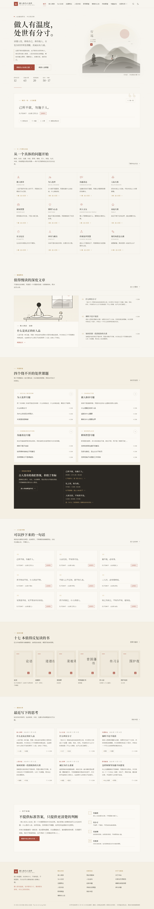
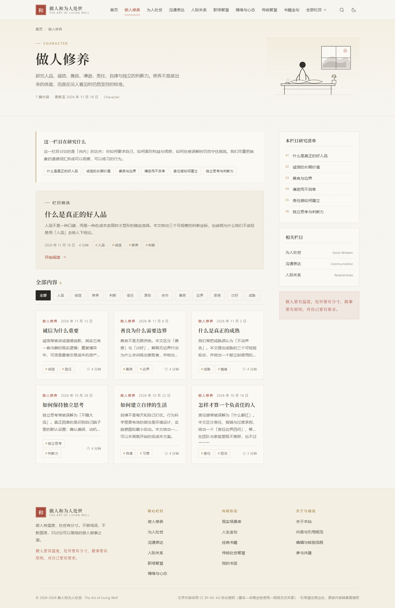
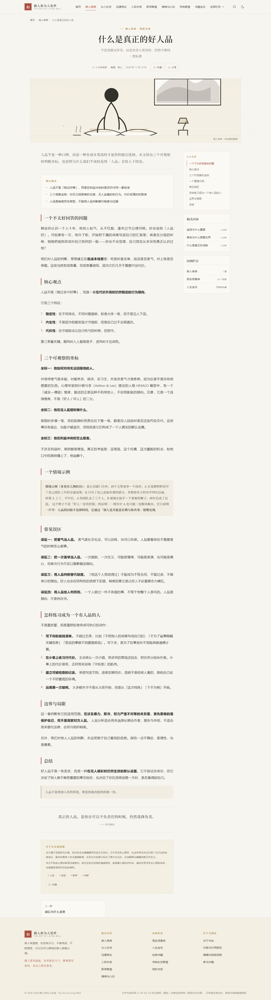
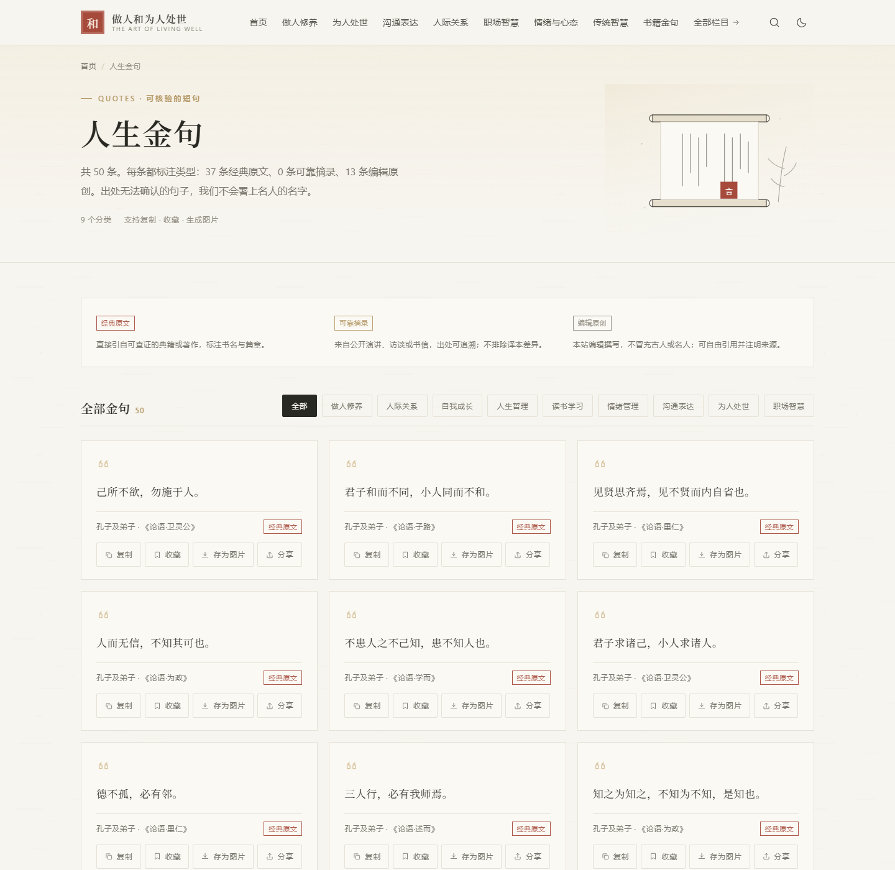
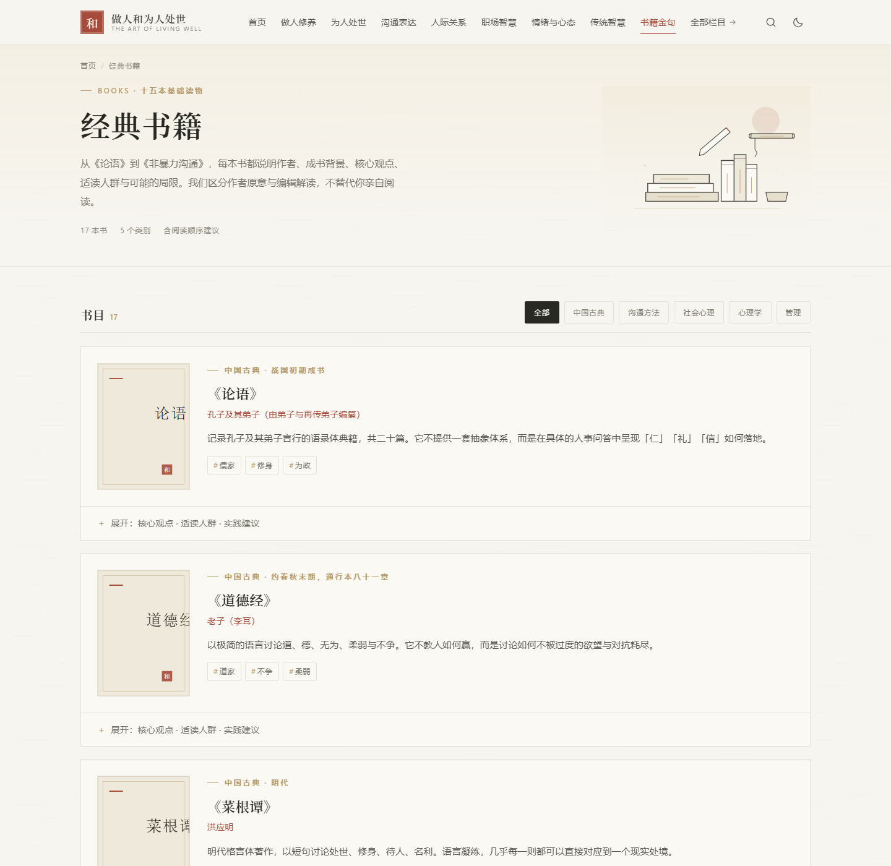
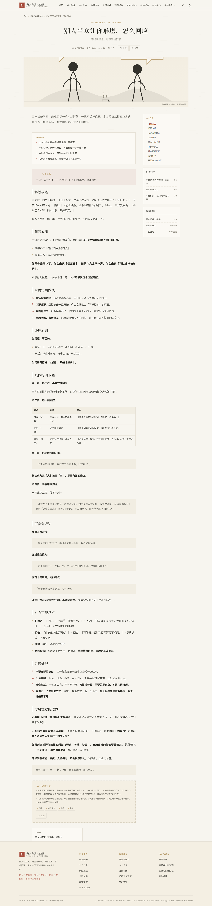
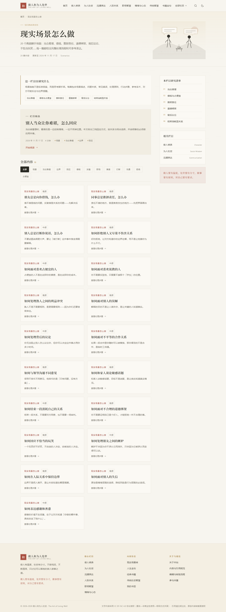

# 做人和为人处世 · The Art of Living Well

> 做人有温度，处世有分寸，做事有原则，对自己有要求。

一个系统研究**做人修养、为人处世、人际关系、沟通表达、职场智慧、家庭关系、情绪管理**与**传统处世智慧**的中文知识库。

不是鸡汤站，也不教圆滑世故。这里的每一篇内容都要求：有核心观点、有逻辑推演、有可核验的出处、有具体可执行的做法，并明确写出适用条件与局限。

在线访问：<https://yuxinrun.github.io/art-of-living-well/>

---

## 目录

- [项目简介](#项目简介)
- [内容规模](#内容规模)
- [功能特性](#功能特性)
- [技术架构](#技术架构)
- [目录结构](#目录结构)
- [本地运行](#本地运行)
- [构建与预览](#构建与预览)
- [GitHub Pages 部署](#github-pages-部署)
- [内容维护](#内容维护)
- [图片与 SVG](#图片与-svg)
- [SEO 与性能](#seo-与性能)
- [可访问性](#可访问性)
- [数据与隐私](#数据与隐私)
- [截图](#截图)
- [贡献指南](#贡献指南)
- [版权与引用规范](#版权与引用规范)
- [已知局限](#已知局限)
- [License](#license)

---

## 项目简介

「做人和为人处世」试图回答十四个问题：什么是真正的好人品、如何做一个有修养有原则的人、如何理解人性与人际关系、如何与不同性格的人相处、如何把话说得得体清晰有力量、如何拒绝而不陷入内疚、如何面对不尊重自己的人、如何处理利益与人情、如何在职场建立良好关系、如何经营家庭友情与亲密关系、如何管理情绪与冲突、如何在复杂关系中保持独立与边界、如何从传统与现代思想中获得智慧、如何把道理转化为日常行动。

三条编辑原则：

1. **不做人格审判。** 讨论行为、结构、条件与代价，不给读者或当事人贴心理诊断标签。
2. **不伪造出处。** 名言引用区分「经典原文」「可靠摘录」「编辑原创」；古籍注明版本差异；引用不确定时标注「出处待考」或改标编辑原创。
3. **不承诺万能答案。** 每个话术都附带适用情境、风险和边界；涉及法律、医疗、安全的问题，明确建议走专业渠道。

## 内容规模

| 类型 | 数量 | 说明 |
|---|---|---|
| 深度文章 | 63 篇 | 覆盖 10 个内容栏目，每篇含核心观点、行为逻辑、情境示例、常见误区、行动清单、参考资料 |
| 现实场景指南 | 20 篇 | 统一模板：场景描述 → 问题本质 → 常见错误 → 处理原则 → 行动步骤 → 可参考表达 → 对方反应 → 后续处理 → 边界 |
| 传统智慧专题 | 12 篇 | 《论语》《道德经》《大学》《中庸》《菜根谭》《曾国藩家书》《传习录》《围炉夜话》《小窗幽记》 |
| 人生金句 | 50 条 | 分类、作者、出处、引用类型、解释、现实情境、实践建议、标签 |
| 书籍介绍 | 17 本 | 作者、核心观点、适读人群、值得思考的问题、实践建议、相关文章 |
| 研究栏目 | 12 个 | 做人修养、为人处世、沟通表达、人际关系、职场智慧、情绪与心态、识人交友、家庭关系、社交礼仪、冲突与解决、传统处世智慧、现实场景 |
| 阅读合集 | 6 个 | 按主题串联文章，形成阅读路径 |
| 静态页面 | 101 个 | 全部预渲染为独立 HTML，正文可被搜索引擎直接抓取 |

## 功能特性

- **全站搜索**：基于构建期生成的 `search-index.json`，支持标题、摘要、标签、金句、书籍的模糊匹配，`<dialog>` 实现，键盘可操作。
- **栏目与标签筛选**：栏目页、场景页、书籍页均支持即时筛选，URL 参数可分享。
- **每日一句 / 随机金句**：按日期取种子，同一天全站一致；支持随机切换。
- **金句卡片**：Canvas 1080×1350 生成可下载图片，含站点署名，不依赖第三方服务。
- **收藏与最近阅读**：文章收藏、金句收藏、阅读记录全部存在 `localStorage`，不上传任何数据。
- **阅读体验**：阅读进度条、自动目录（随滚动高亮）、返回顶部、上一篇/下一篇、相关阅读、分享（Web Share API + 复制链接兜底）。
- **深色阅读模式**：跟随系统，可手动切换并持久化，无闪白。
- **移动端导航**：汉堡菜单 + 焦点管理，桌面端吸顶导航，当前栏目高亮。
- **无外部依赖**：不加载远程字体、图表库、统计脚本；断网也能完整阅读。

## 技术架构

| 层 | 方案 | 说明 |
|---|---|---|
| 构建 | Vite 5 | 只打包 1 个 CSS 与 1 个 JS 入口，产物极小 |
| 内容 | Markdown + YAML frontmatter | 自研解析器（`scripts/lib/`），零第三方依赖 |
| 渲染 | 自研静态站点生成器 | 构建期输出 `pages/**/index.html`，构建后提升到 `dist/` 根目录，得到干净 URL |
| 样式 | 原生 CSS | CSS 变量 + 明暗双主题，`clamp()` 响应式，无预处理器 |
| 交互 | 原生 JavaScript（ES Module） | 无框架、无 polyfill，`target: es2019` |
| 图形 | 手写 SVG | Hero、栏目插画、纹理、图标全部原创，本地文件 |
| 部署 | GitHub Actions → GitHub Pages | `BASE_PATH` 环境变量适配仓库子路径与自定义域名 |

构建流程：

```
content/*.md  ─┐
data/*.json   ─┼─► scripts/generate.js ─► pages/**/index.html + sitemap.xml + robots.txt + search-index.json
               │                                    │
               └──────────────► vite build ◄────────┘ ─► dist/（101 个 HTML + 静态资源）
```

## 目录结构

```
art-of-living-well/
├─ .github/workflows/deploy.yml     # 推送 main 自动构建并部署到 GitHub Pages
├─ content/                         # 全部内容，一个 Markdown 一个页面
│  ├─ character/                    # 做人修养（7）
│  ├─ social-wisdom/                # 为人处世（5）
│  ├─ communication/                # 沟通表达（11）
│  ├─ relationships/                # 人际关系（3）
│  ├─ workplace/                    # 职场智慧（7）
│  ├─ emotions/                     # 情绪与心态（4）
│  ├─ understanding-people/         # 识人交友（3）
│  ├─ family/                       # 家庭关系（5）
│  ├─ etiquette/                    # 社交礼仪（3）
│  ├─ conflict-resolution/          # 冲突与解决（3）
│  ├─ chinese-wisdom/               # 传统处世智慧（12）
│  ├─ scenarios/                    # 现实场景怎么做（20）
│  └─ pages/about.md                # 关于本站
├─ data/
│  ├─ site.json                     # 站点名称、域名、编辑、授权
│  ├─ navigation.json               # 顶部导航与页脚结构
│  ├─ categories.json               # 12 个栏目的元数据（含插画）
│  ├─ quotes.json                   # 50 条金句
│  ├─ books.json                    # 17 本书
│  └─ collections.json              # 6 个阅读合集
├─ docs/
│  ├─ image-credits.md              # 图片与 SVG 来源、授权清单
│  └─ screenshots/                  # 真实网页截图（README 引用）
├─ public/assets/
│  ├─ illustrations/                # 8 张原创 SVG 插画
│  ├─ icons/favicon.svg             # 站点图标
│  ├─ backgrounds/paper.svg         # 纸张纹理
│  └─ images/og-cover.png           # 社交分享封面 1200×630
├─ scripts/
│  ├─ generate.js                   # 生成入口：读内容 → 渲染 → 写 pages/
│  └─ lib/
│     ├─ content.js                 # Markdown + frontmatter 解析、排序、聚合
│     ├─ markdown.js                # 自研 Markdown 渲染器（含自定义锚点）
│     ├─ ui.js                      # <head>、导航、页脚、卡片等通用片段
│     ├─ views.js                   # 首页 / 栏目 / 文章 / 场景视图
│     └─ views-library.js           # 金句 / 书籍 / 合集 / 书签 / 404 视图
├─ src/
│  ├─ styles/                       # base.css / components.css / pages.css / main.css
│  ├─ scripts/                      # core / search / filters / quotes / article / library / main
│  └─ generated/search-index.json   # 构建期生成（git 忽略）
├─ index.html                       # Vite 入口（实际内容由生成器产出）
├─ vite.config.js                   # 多页输入 + 路径提升 + sitemap/robots 拷贝
└─ package.json
```

## 本地运行

环境要求：Node.js ≥ 18（推荐 20 LTS）。

```bash
npm install
npm run dev        # http://127.0.0.1:5173
```

`npm run dev` 会先执行一次内容生成，随后监听 `content/` 与 `data/`，改动后自动重建并刷新页面。

## 构建与预览

```bash
npm run build      # 生成内容 + 打包 → dist/
npm run preview    # 预览构建产物 http://127.0.0.1:4173
```

单独重新生成 HTML（不打包）：

```bash
npm run generate
```

部署到子路径（GitHub Pages 项目站）时指定 `BASE_PATH`：

```bash
# macOS / Linux
BASE_PATH=/art-of-living-well/ npm run build

# Windows PowerShell
$env:BASE_PATH='/art-of-living-well/'; npm run build
```

## GitHub Pages 部署

仓库已内置 `.github/workflows/deploy.yml`：**推送到 `main` 即自动构建并发布**。

首次部署步骤：

1. 把仓库推送到 GitHub，确认默认分支是 `main`。
2. 打开仓库 **Settings → Pages**。
3. 在 **Build and deployment → Source** 中选择 **GitHub Actions**（不要选 “Deploy from a branch”）。
4. 打开 **Actions** 标签页，等待 `Deploy to GitHub Pages` 运行完成。
5. 访问 `https://<用户名>.github.io/art-of-living-well/`。

工作流会自动把 `BASE_PATH` 设为 `/<仓库名>/`，因此静态资源、页面链接、`sitemap.xml` 都能在子路径下正常工作。

**绑定自定义域名（根路径部署）：**

1. 在仓库 **Settings → Pages → Custom domain** 填入域名并保存（会生成 `CNAME` 文件）。
2. 在 **Settings → Secrets and variables → Actions → Variables** 新建变量 `BASE_PATH`，值为 `/`；再新建 `SITE_URL`，值为 `https://你的域名`（不带结尾斜杠）。
3. 重新运行工作流。DNS 建议添加 `CNAME` 记录指向 `<用户名>.github.io`，并在 Pages 中勾选 **Enforce HTTPS**。

`SITE_URL` 只影响构建期生成的 canonical、`og:url`、`sitemap.xml` 与 `robots.txt`；不设置时回退到 `data/site.json` 的 `url` 字段。两者保持一致即可。

## 内容维护

### 新增一篇文章

在对应栏目目录下新建 Markdown 文件，例如 `content/character/honesty.md`，文件名即 URL（`/character/honesty/`）：

```markdown
---
title: 诚信为什么重要
subtitle: 一次说谎的成本，比你想象的长
summary: 用在 80–120 字内说明这篇文章解决什么问题、给出什么方法。
date: 2026-11-20
tags: [诚信, 信任, 长期主义]
featured: true
cover: reading-cultivation.svg
keyPoints:
  - 诚信的本质是降低他人与你合作的风险成本
  - 一次失信的代价往往延迟出现
quote: 信用是慢慢存进去的，取出来只需要一次。
---

## 核心观点

正文……

## 参考资料

- 作者. 《书名》. 出版社, 年份.
```

**frontmatter 字段说明**

| 字段 | 必填 | 说明 |
|---|---|---|
| `title` | 是 | 页面 H1 与 `<title>` |
| `subtitle` | 否 | 副标题，显示在标题下方 |
| `summary` | 是 | 摘要，用于列表卡片、`<meta description>`、结构化数据 |
| `date` | 是 | 发布日期（`YYYY-MM-DD`），同时用于排序与 `lastmod` |
| `updated` | 否 | 更新时间，优先于 `date` 出现在 sitemap 与 Article schema |
| `tags` | 否 | 标签数组，参与筛选与搜索 |
| `featured` | 否 | `true` 时进入首页编辑精选 |
| `cover` | 否 | 插画文件名（不含路径），默认按栏目回退 |
| `keyPoints` | 否 | 文章要点列表，显示在正文前 |
| `quote` | 否 | 全文金句，显示在文末重点引用块 |
| `classic` / `classicSource` / `classicLine` / `original` | 传统智慧栏目专用 | 典籍名、篇目出处、一句原文、原文段落 |
| `oneliner` / `level` | 场景栏目专用 | 一句话总结、出现频率（高频/中频） |

正文约定：

- `##` 为一级小节，`###` 为二级；标题会进入自动目录。
- 需要固定锚点时写作 `## 具体行动步骤 {#steps}`。
- 引用块 `>` 渲染为东方人文风格的重点块；`==文字==` 渲染为标记高亮。
- 表格支持横向滚动，图片必须写 `alt` 与图注。

### 新增一条金句

编辑 `data/quotes.json`：

```json
{
  "id": "q-051",
  "text": "真正的善良，不是没有锋芒，而是有能力伤害别人，却仍然选择尊重。",
  "category": "做人修养",
  "author": "编辑原创",
  "source": "",
  "type": "editorial",
  "explain": "善良是一种选择，前提是你有能力选择别的。",
  "scene": "当你想用「我只是善良」来解释长期退让时。",
  "practice": "把「我愿意」和「我不敢」分开写一次。",
  "tags": ["善良", "边界"]
}
```

`type` 取值：`classic`（经典原文）、`excerpt`（可靠摘录）、`editorial`（编辑原创）。**出处无法确认时，`author` 必须写「编辑原创」或留空，不得署名名人。**

### 新增一本书

编辑 `data/books.json`，字段：`id`、`title`、`author`、`year`、`category`、`summary`、`ideas`（核心观点数组）、`readers`（适合谁读）、`questions`（值得思考的问题）、`practice`、`related`（相关文章 slug 数组）、`cover`（可选）。

### 新增一个阅读合集

编辑 `data/collections.json`，用 `articles` 数组按 slug 串联已有文章，即可在首页与 `/library/` 中出现新的阅读路径。

### 修改栏目

`data/categories.json` 控制栏目名称、路径、图标、简介、研究议题与栏目插画。新增栏目时需同时在 `content/` 下建立同名目录，否则该栏目页为空。

## 图片与 SVG

- 所有插画位于 `public/assets/illustrations/`，为**手写原创 SVG**，无外部依赖、可无限缩放。
- 新增图片必须登记到 [`docs/image-credits.md`](docs/image-credits.md)，写清来源与授权。
- 位图优先转为 WebP，宽度不超过 1600px，首屏图使用 `fetchpriority="high"`，其余 `loading="lazy"`。
- 插画统一构图：`viewBox 0 0 420 300`（栏目插画）/ `0 0 760 680`（Hero），配色限定在 Design System 的米白、墨黑、灰褐、朱砂范围内。

**Design System 速查**

```css
--paper: #F7F5EF;   /* 页面背景 */
--ink: #292923;     /* 主文字 */
--muted: #77746B;   /* 次要文字 */
--accent: #A64B3C;  /* 朱砂强调 */
--gold: #B69A69;    /* 辅助色 */
--line: #E6E1D6;    /* 边框 */
--radius: 2px;      /* 克制的圆角 */
```

## SEO 与性能

- 每个页面独立 `title`、`meta description`、`canonical`、`og:*`、`twitter:card`。
- 结构化数据：`WebSite`、`Organization`、`CollectionPage`、`Article`、`BreadcrumbList`、`ItemList`、`AboutPage`。
- `sitemap.xml`（99 条 URL）与 `robots.txt` 在构建期生成；`/library/` 标记 `noindex`（内容依赖浏览器本地数据）。
- 全部页面预渲染为静态 HTML，无客户端路由，禁用 JS 仍可阅读正文与跳转。
- 单页 CSS 约 43 KB（gzip 8.9 KB），JS 约 20 KB（gzip 7.8 KB），搜索索引按需加载。
- 不加载远程字体与第三方脚本，图片使用固定宽高比，避免布局偏移（CLS）。

## 可访问性

- 语义化结构：`header / nav / main / article / aside / footer`，标题层级不跳级。
- 跳转到主内容的「跳到正文」链接，键盘可见的焦点样式。
- 搜索使用原生 `<dialog>`，支持 `Esc` 关闭与焦点回收。
- 所有图标按钮带 `aria-label`，装饰性 SVG 带 `aria-hidden="true"`。
- 尊重 `prefers-reduced-motion`，关闭过渡与动画。
- 深色模式对比度按 WCAG AA 校验。

## 数据与隐私

收藏、金句收藏、最近阅读、主题偏好全部保存在浏览器 `localStorage`：

| 键 | 内容 |
|---|---|
| `alw:favs` | 收藏的文章 slug |
| `alw:quotes` | 收藏的金句 id |
| `alw:recent` | 最近阅读（最多 12 条） |
| `alw:theme` | `light` / `dark` / 跟随系统 |

**没有后端服务，没有账号系统，不上传任何用户数据。** 清除浏览器数据即清空所有记录，`/library/` 页面对此有明确说明。

## 截图

以下截图均为本地 `npm run build` 后用 Chrome DevTools Protocol 抓取的真实页面渲染结果（1440px 桌面 / 390px 手机），未做后期合成。

### 首页（桌面，全页）



### 首页（手机）


### 栏目列表页



### 深度文章详情页



### 人生金句



### 经典书籍



### 现实场景指南



### 场景库总览



## 贡献指南

欢迎补充内容、修正错误、改进可访问性。提交前请确认：

1. **事实与出处**：引用古籍请附篇名；引用研究请给出作者、年份与期刊；无法核实的表述请改为编辑观点。
2. **区分事实与判断**：案例若为综合虚构，必须标注「情境示例」，不得冒充真实人物经历。
3. **不做诊断**：不使用「自恋型人格」「PUA」等标签给具体的人下结论。
4. **不留 TODO**：提交的内容应当是完整可读的，不允许占位段落。
5. **构建通过**：`npm run build` 无报错，且没有新增失效链接或图片。
6. **一处一提交**：内容、样式、脚本分开提交，commit message 使用 `feat:` / `fix:` / `content:` / `docs:` / `chore:` 前缀。

## 版权与引用规范

- 本站原创文字与插画采用 **CC BY-NC 4.0**（署名—非商业性使用—相同方式共享）。
- 转载或引用请注明来源「做人和为人处世」并附原文链接，不得用于商业用途。
- 古籍原文属公有领域；白话解释、案例分析、行动建议为本站原创，受上述协议保护。
- 涉及现代著作（如《非暴力沟通》《思考，快与慢》）时，仅作观点概述与评论，不复制原文段落，引用篇幅控制在合理使用范围内。
- 若你认为本站内容侵犯了你的权利，请通过仓库 Issue 联系，我们会核实并删除。

## 已知局限

- 内容偏重中文语境下的人际与职场情境，跨文化适用性有限。
- 心理学部分以介绍性引用为主，不构成临床建议；涉及心理困扰请寻求专业帮助。
- 场景话术是**示例**，不是标准答案。同一句话在不同关系、不同权力结构下的效果可能相反，请结合「边界」一节自行判断。
- 搜索为前端字符串匹配，未做分词与语义检索，长句查询效果有限。
- 无评论系统与后台，内容更新依托 Git 工作流。

## License

- **代码**（`scripts/`、`src/`、`vite.config.js`、`.github/`）：MIT。
- **文字与插画**（`content/`、`data/`、`public/assets/`、`docs/`）：CC BY-NC 4.0。

详见 [`docs/image-credits.md`](docs/image-credits.md)。